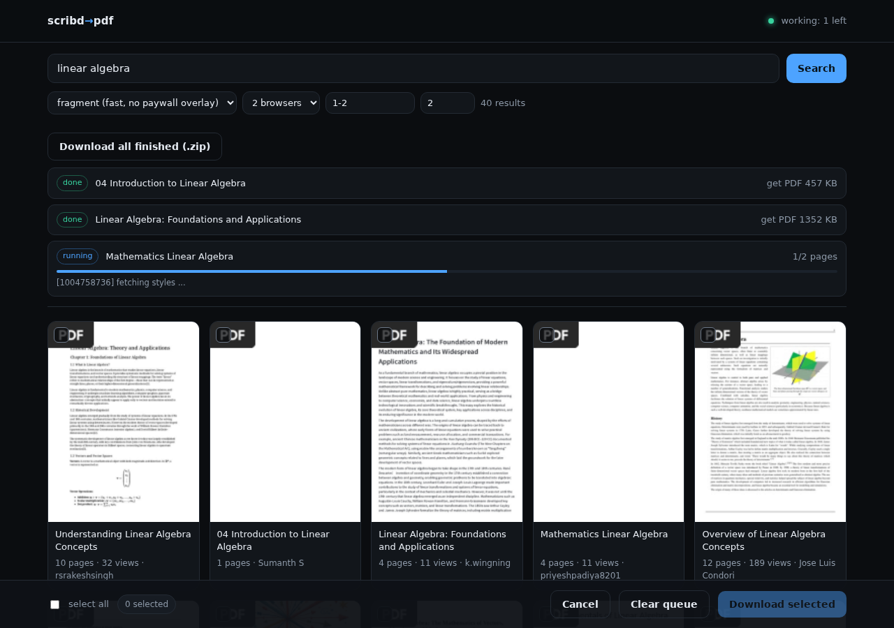

# Scribd → PDF

Two tools, one diagnosis. Start with **`scribd_shot.py`** — it is the simplest
strategy that works for every document kind:

> open the document in headless Chromium, screenshot each page box, bind the
> images into a PDF, one PDF page per screenshot.

```
python scribd_shot.py 949773556 -o out
```

`scribd_pdf.py` is the alternative from the previous round: it rebuilds the page
HTML and prints a **text-based** PDF (selectable text, ~10x smaller). Keep it if
you need copy/paste; use `scribd_shot.py` if you want pixels and nothing else.

---

## 0. Search says "Scribd served its bot challenge" → use CloakBrowser

This is the one failure that is **not** about your code, your cookies or your IP.

Scribd's edge (Fastly) answers a first-time request with a `Client Challenge`
page. That page solves itself in a browser whose fingerprint it trusts, and
**never** in plain Chromium. Measured on one machine, one IP, same minute:

| browser | result after 12-18 s |
| --- | --- |
| `curl` | `406` + `scribd_ubtc` cookie |
| Playwright headless shell | still `Client Challenge` |
| **full** Chrome for Testing 156, `AutomationControlled` disabled | still `Client Challenge` |
| **CloakBrowser** (same machine, same IP) | `Search \| Scribd` in **3 s** |

So waiting longer, reloading, adding a user agent, or moving to another network
does not fix it: the edge is fingerprinting the browser, not judging the address.
Switching to full Chrome is not enough either — that was measured too.

### It is the default now — nothing to switch on

`requirements.txt` contains `cloakbrowser`, so the panel installs it with
everything else, and `run.py` provisions its chrome and libraries at boot (no
root, no `playwright install`). A bare box with no `.env` at all boots straight
into the stealth engine:

```
browser : cloakbrowser 0.6.4 (stealth) -> /home/container/.cloakbrowser/chromium-146.../chrome
```

First boot only: ~150 MB chrome download into `~/.cloakbrowser`, then 4-8
library rounds (`libatk-bridge2.0-0 libcups2 libxkbcommon0 libatspi2.0-0
libxdamage1 libasound2 libavahi-common3 libavahi-client3`), then `it started`.
Every later boot skips all of it.

Plain Chromium is still reachable with `SCRIBD_BROWSER=chrome` if you ever need
to prove the stealth build is not the cause of something — it will be
challenged, that is the point of the comparison.

To provision by hand: `python chromium_setup.py --engine cloak --fetch-libs`.

One cosmetic notice on Linux: CloakBrowser spoofs Windows, so it warns that the
box has no real Windows fonts (Segoe UI, Calibri, Consolas). Those cannot be
fetched legally without a Windows licence — drop `.ttf` files into `~/.fonts`
if you want them, or silence the notice with
`CLOAKBROWSER_SUPPRESS_FONT_WARNING=1` in `.env`.

Three things worth knowing:

* Unset, `auto`, and `cloak` all mean the stealth engine; it never falls back to
  plain Chromium silently — that would put you straight back on the challenge
  page. `SCRIBD_BROWSER=chrome` is the only way to get plain Chromium.
* The binary is **proprietary** (its own Binary License, free tier = Chromium
  146 with 58 fingerprint patches, 1 concurrent session). The Python wrapper is
  MIT. This is the one non-free piece the tool pulls in — say the word and it
  goes back to opt-in.

Verified end to end through **this** tool, on a Linux ARM64 container with no
root: search returned 40 rows; the web UI downloaded a document through its job
queue (3/3 pages, 8 s); and `scribd_all.py 949773556` produced a real 7-page PDF
in 18 s (`Free Sample PDF Files for Testing…`). Pages were pulled back out of the
PDFs and inspected — real text, correct page footers, no blank sheets.

While the challenge is up the tool waits for the interstitial to clear and only
then reports an error, saying which backend it used and what would fix it.

### Two behaviours of the stealth build worth knowing

* **`page.set_content()` never finishes.** Its `load` event does not fire — even
  `<h1>hello</h1>` times out after 120 s. Both engines therefore write the batch
  to `.tmp/_batch.html` and navigate to it with `file://` instead, which fires in
  ~1 ms and still loads images from the CDN. If you extend the tool, use
  `_load_html()` rather than calling `set_content()` directly.
* **Do not paste a UA over it.** CloakBrowser ships a coherent UA + fingerprint;
  overriding `user_agent=DEFAULT_UA` on top makes the two disagree. `_new_context()`
  drops the override on that backend.

---

## 1. `scribd_shot.py` — screenshot every page

**The pipeline is the same for every document type** — text pages, scans, slide
decks, comic pages:

```
Scribd document  ──►  #outer_page_1 … #outer_page_N   (live reader DOM)
                          │ scroll into view, wait for content,
                          │ hide anything painted over the page
                          └─ screenshot .newpage  ──►  0001.jpg 0002.jpg …
                                          │
                                          └─ img2pdf  ──►  document.pdf
```

* **Page boundaries are exact** — the screenshot *is* the page box
  (`#outer_page_N .newpage`), never a scroll region stitched together.
* **PDF geometry matches the original** — the document's own page size (from its
  `width`/`height`) is used for the PDF page, so a 902×1167 page comes out as
  676×876 pt, and thumbnails/print look like the source.
* **Resolution** — `--scale 2` (default) means 2 device pixels per CSS pixel =
  **192 dpi**, which is crisp for reading and zooming. `--scale 3` for small
  print, `--scale 1` to go faster / smaller.
* **Nothing extra baked in** — before each shot, an `elementsFromPoint` sweep
  over the page box hides every overlay (consent banner, floating reader widget,
  ad iframes, sticky bars, shadow-DOM widgets). Verified with injected fake
  overlays: zero pixels survived.
* **Blank detection** — each screenshot is checked for being featureless, so you
  are told *"2 captured page(s) look blank"* instead of silently getting white
  pages.

### Two engines, same output

| | `--engine auto` (default) / `--engine live` | `--engine fragment` |
|---|---|---|
| what it does | screenshots the real Scribd reader page — maximum fidelity; auto never changes renderers | fetches the page fragments, rebuilds the pages, screenshots those |
| speed | ~1 page/s | ~4 pages/s |
| works for | documents the live reader can load | any document, including ones whose reader crashes |
| needs | the reader to start; explicit `live` also needs `--allow-live` | `scribd_pdf.py` next to it |

`--engine auto` (the default) uses the live reader only. It never retries with a
different renderer, including after capture errors, incomplete pages, paywalls,
or on very large documents. This avoids silently changing page geometry and
reintroducing clipping or incorrect PDF dimensions. If you want the fragment
renderer, select `--engine fragment` explicitly; if the live reader fails, the
job reports that failure rather than switching renderers.

### Use

```bash
python scribd_shot.py 949773556 -o out                    # 7 pages, ~14 s
python scribd_shot.py 949773556 --pages 1-20 --scale 3    # only pages 1-20, 288 dpi
python scribd_shot.py 1062697898 --format png            # lossless screenshots
python scribd_shot.py 949773556 --keep-pages             # keep 0001.jpg …
python scribd_shot.py 1234567                            # private: cookies from .env
python scribd_shot.py 1234567 -c cookies.txt             # or a jar, if you have one
python scribd_shot.py 838866095 --pages 1-50 --engine fragment   # very long docs

# scale-out and caching
python scribd_shot.py 838866095 --engine fragment --tabs 4        # 4 browsers in parallel
python scribd_shot.py 949773556 --cache ~/.cache/scribd           # re-runs are instant
python scribd_shot.py 949773556 --pdf-engine mupdf                # smallest lossless PDF
python scribd_shot.py 949773556 --net-log audit/                  # dump what the viewer got
```

Options: `-o/--outdir`, `-c/--cookies`, `--cookies-env`, `--scale`,
`--format {jpg,png}`, `--quality`, `--pages`, `--engine {auto,live,fragment}`,
`--settle`, `--timeout`, `--keep-pages`, `--offload/--no-offload`, `-v`.

Measured (this machine):

| document | pages | engine | time | PDF | page size |
|---|---|---|---|---|---|
| 949773556 (text) | 7 | live | 13.8 s | 1.46 MB | 676×876 pt |
| 596761986 (text+images) | 2 | live | 7.9 s | 0.67 MB | 676×956 pt |
| 1062697898 (scan) | 6 | live | 13.2 s | 2.68 MB | 676×956 pt |
| 838866095 (6,154 pp, first 6) | 6 | fragment | 3.9 s | 3.12 MB | 676×956 pt |
| 879249648 (private) | 2 | live | 8.7 s | 53 KB | blank — needs cookies |

---

## 2. Tier 2 items: what is real here, what isn't

I measured Scribd's viewer before building anything. Findings:

```
workers           : 2 blob: workers (used for ad/analytics, not for page decode)
canvases          : 4 x .highlighter_canvas (annotation layer, always empty)
drawImage patched : no  (Scribd never draws pages to canvas)
page transport    : JSONP text fragments +  assets, one per page
tiles             : none - pages are whole images, not a tile grid
```

So, item by item:

| Tier 2 item | Verdict for Scribd | What I did |
|---|---|---|
| **Fetch-domain interception (CDP)** | Real, but not worth it as the *capture* path: the live `` is already sized for reading (812×1086), and page images are blank placeholders for text documents. | Implemented as `--net-log DIR`: response bodies are read through CDP and written to disk with an `index.json`. It is genuinely useful for **auditing/debugging** (it proved above that `drawImage` is never patched and that `.jsonp` fragments are plain `script` responses) — cheap, because no rendering is involved. |
| **Hook the viewer's pipeline (`drawImage`, `createImageBitmap`, `onload`)** | **Not applicable.** Scribd positions text with spans and images with ``; it never decodes pages through canvas. Hooking would capture the highlight overlay. | Skipped, with the evidence above. `scribd_pdf.py` already does the equivalent "collect what the viewer would paint" job at the DOM level, and produces *selectable text* instead of pixels. |
| **Tile stitching** | **Not applicable.** No tile grid exists. | Skipped. |
| **`Page.startScreencast` frames** | Technically possible, but strictly worse than `element.screenshot()`: compositor frames arrive at viewport resolution, may be partial/dirty rects, and need reassembly. | Skipped. |
| **Warm browser pool with injected scripts** | Marginal: browser launch is ~0.3 s of a ~1.3 s/page cycle. The real win at scale is not starting a browser at all (see cache + `--tabs`). | Implemented the cheaper 80%: **content-addressed cache** and **parallel capture workers**, both measured below. |

### What I implemented, and the measured effect

| Feature | Flag | Measured |
|---|---|---|
| **Content-addressed page cache** — page images keyed by Scribd's own fragment hash (`pages/7-d3bf133d02.jsonp`) + scale/format/quality | `--cache DIR` | 240-page job where 180 were already cached: **180 hits / 60 misses, 18.3 s** |
| **Finished-PDF cache** — a re-run of the same job never launches a browser | `--cache DIR` | **15.1 s → 0.34 s** |
| **Parallel capture workers** — one browser per thread, failures retried sequentially, fan-out clamped to `os.cpu_count()` | `--tabs N` | 180 pages: **33.9 s → 24.3 s** on a **2-core / 1 GB** box (1.4x). At `--tabs 6` on 2 cores it collapsed (83 failed pages) — hence the clamp + retry; that scenario now completes cleanly in 24.2 s. On a 8-core box the same code scales linearly; the cap is Chromium's ~250 MB per browser. |
| **Lossless PDF assembly choice** — MuPDF re-encodes with Flate, img2pdf embeds JPEGs untouched; `auto` builds both and keeps the smaller | `--pdf-engine {auto,img2pdf,mupdf}` | text-heavy capture: **12,654 KB → 4,408 KB (2.9x smaller, same pixels)**; photo scans: no change (auto keeps img2pdf) |
| **CDP-level response capture** | `--net-log DIR` | 40 responses (css + `ffN` woff2 + page fragments) dumped with index, **no extra requests** |

### Tier 3, briefly

* **Browserless rendering (PDFium/MuPDF/WASM)** — this is the correct answer *if you can
  get a source file*. Here there is no source PDF to render: Scribd serves HTML +
  reused webfonts, and reconstructing the PDF means running a browser layout engine.
  The one place a native engine does help is assembly — that's the `--pdf-engine mupdf` path above.
* **Reimplementing the viewer protocol** — already done: `scribd_pdf.py` speaks the
  fragment + font protocol with plain HTTP (no DOM), which is why the fragment engine
  runs ~4x faster than the live reader and survives documents whose reader OOMs.
* **Distributed workers** — `--tabs` is the single-box version. The seam for a queue is
  clean (one `Capture` per document, cache keys are portable), but on this target the
  bottleneck is per-page Chromium layout, so the win comes from caching first, then cores.
* **GPU encoding** — irrelevant below ~50 pages/s; JPEG encode is not the bottleneck here.
* **Fingerprint spoofing / anti-bot evasion** — not implemented, deliberately. There is no
  bot wall on public Scribd documents: everything above works with a stock headless UA.
  For subscription-only documents the honest path is your own logged-in session
  (`--cookies`), not evasion.

---

## 3. Ads, black boxes and blurred pages

Three different things get called "ads" on Scribd. They need three different fixes:

| What you see | What it actually is | Fix |
|---|---|---|
| Banner/sidebar ads, sticky bars, floating widgets | third-party ad & tracker iframes | **blocked at the network layer** (below) |
| **Black rectangle** in the middle of a page | an ad **iframe whose request never loaded** — it has a size and a background but no content | same: blocking the request means an *aborted* iframe paints nothing, instead of an empty black box. Hiding the element is not enough, which is why ad *hiders* leave black holes. |
| Blurred text + "Unlock the next 20 pages after an ad" | Scribd's **paywall interstitial** — first-party, not an ad. Ad blockers don't remove it because it is the site's own gate. | `--engine fragment` — the page fragments are **not gated**, only the reader's overlay is |

### Ad blocking (built in, on by default)

Requests matching `AD_HOST_RE` (googlesyndication, doubleclick, amazon-adsystem,
taboola, outbrain, criteo, pubmatic, casalemedia, adnxs, moatads, scorecardresearch,
surveymonkey/survicate, hotjar, …) are **aborted through CDP routing**, before they
hit the network — the browser equivalent of a uBlock filter, applied to the
screenshot browser. Measured on document 272351848: **39 requests blocked, 0 ad
iframes left in the DOM**.

On top of that, any element painted over the page box is hidden before each shot
(the `elementsFromPoint` sweep), and the consent banner is accepted/removed.

### Paywall detection

After the live reader loads, its visible text is checked against `PAYWALL_MARKERS`
("Unlock the next…", "subscribe to read", …). If the gate is up:

* `--engine auto` (default) → the reader reports the paywall; it does not switch
  renderers automatically. Add Scribd cookies or explicitly select `fragment`;
* `--engine live` → you get an explicit warning instead of silently blurred pages.

For document 272351848 all 36 pages are served as complete fragments with
`blur: false` — the blur only exists in the reader's overlay. It is also 3-10x
faster that way:

```bash
python scribd_shot.py 272351848 -o out --engine fragment     # clean, ~4x faster
```

### Why an ad blocker in your own browser is not the answer here

Brave/uBlock help *you* browse, but the PDF was produced by a headless browser with
its own network stack — your desktop blocker was never in the loop. Pointing Chrome
at a proxy/filter is possible but it does not solve the paywall anyway, since the
gate is served by Scribd itself.

---

## 4. Why the old scripts produced blank PDFs

They weren't crashing. They were succeeding at the wrong thing.

Scribd serves almost every document as an **HTML text layer**, and the
`html.scribdassets.com/.../images/<n>-<hash>.jpg` URLs the original code built are
**not the document pages**. They are either

* HTTP **403** (`<Error><Code>AccessDenied</Code>`), or
* a **904×1169 blank white placeholder** (exactly 7,152 bytes, byte-identical for
  every page of the document).

So `download.py` dutifully collected N identical white JPEGs, `build_pdf.py`
stapled them together, and you got a "successful" PDF with N blank pages.

Run this and see for yourself:

```bash
python scribd_pdf.py https://www.scribd.com/document/949773556 -o out
```

---

## What was actually broken (all verified against live Scribd)

| # | Your code | Reality |
|---|-----------|---------|
| 1 | `extract.py` derived the page image as `pages/<n>-<hash>.jsonp` → `images/<n>-<hash>.jpg` | The `images/...` path is a *decoration* layer. The real content is in the JSONP fragment (`.jsonp` → an HTML `<div class="newpage">` with `.text_layer` spans and/or `.image_layer` bitmaps). |
| 2 | `download.py` validated downloads with "is it a JPEG/PNG/WEBP?" | A 1×1 or blank white placeholder passes that check. Nothing verified the page **had content**. |
| 3 | `build_pdf.py` used `img2pdf` → tiny PDF | Blank JPEGs compress to almost nothing. A suspiciously small PDF is a symptom, not a feature. |
| 4 | `token.py` posted `csrf_token=` as form data to `/document/<id>/token` | Scribd's own JS posts **JSON** (`{"current_token": "..."}`) with `Content-Type: application/json`. The form-encoded POST gets `403`. The token is only needed for the asset host and most public docs don't need it at all. |
| 5 | `cookies.py` refused to run without `cookies.txt`; the module named `token.py` shadows the stdlib | Both are avoidable: cookies are optional for public documents, and the stdlib-shadowing hack is a code smell that can be removed. |

Measured proof (document 949773556, 7 pages):

```
https://html.scribdassets.com/4q3ppwrfeog3y63d/images/1-8e8bede68a.jpg   -> 200, 7152 B, white page
https://html.scribdassets.com/4q3ppwrfeog3y63d/images/2-e0c4076ad5.jpg   -> 200, 7152 B, white page  (same md5)
https://html.scribdassets.com/.../images/1-0000000000.jpg                -> 403 AccessDenied
https://html.scribdassets.com/4q3ppwrfeog3y63d/pages/1-8e8bede68a.jsonp  -> 200, the actual page markup
```

---

## 5. `scribd_pdf.py` — the text-based alternative

`scribd_pdf.py` is a single file, no shadowing tricks, and it picks the right
pipeline per document:

```
document HTML ──► page manifest (pages/<n>-<hash>.jsonp)
                        │
                        ├─ fragment contains .text_layer  ──►  TEXT document
                        │      rebuild each page into a standalone HTML page,
                        │      using Scribd's own CSS + its `ffN` webfonts
                        │      (from <prefix>/fonts/000N.woff2), then print with
                        │      headless Chromium  ──►  one PDF, real selectable
                        │      text, ~60–160 KB for a 7-page doc
                        │
                        └─ fragment only has .image_layer ──►  SCAN/IMAGE document
                               download the real page bitmap (ranked by visible
                               clip area, blank placeholders rejected) and embed
                               losslessly with img2pdf  ──►  PDF
```

Notable behaviours:

* **Verification, not hope** — every produced PDF is re-opened with `pypdf`:
  page count, and a blank-page scan (text length + embedded images). It warns you
  instead of silently handing over white pages.
* **Honest preview limits** — if Scribd exposes only *k* of *n* pages to
  anonymous visitors (`setupPaidDocument(allowedPagesTemp, total)`), it says so
  up front instead of producing a half-blank PDF.
* **Lazy probing** — a sample of pages decides the pipeline first, so a
  6,154-page document doesn't cost 6,154 requests before it starts.
* **Chunked printing** — documents over 250 pages are printed in batches and
  merged; also, Scribd's page-manager JS is blocked (it only slows things down
  and, on huge documents, hangs the browser).
* **Embedded fonts** — the `ffN` `@font-face` rules Scribd injects at runtime
  are rebuilt from the asset host, which keeps text metrics correct (otherwise
  long lines get clipped at the right margin).
* **`--pages 1-20`** for partial downloads, **`--cookies`** (Netscape *or* JSON
  export) for logged-in documents, **`--debug-dir`** dumps the rebuilt HTML.

---

## 6. Running it on a hosting panel (Pterodactyl / Discord-bot hosts)

### The crash you will hit first

If the panel runs the script as its **Startup command**, then the moment the script
exits the panel decides the *server* crashed and restart-loops it:

```
scribd_shot.py: error: the following arguments are required: URL_OR_ID
[Pterodactyl Daemon]: Detected server process in a crashed state! Exit code: 2
[Pterodactyl Daemon]: Out of memory: false      <-- not a RAM problem
```

**A command-line tool cannot be a panel's Startup command.** It is not about the
exit code: the panel crashed with `Exit code: 0` too. Those eggs restart on *any*
exit, because a "server" is supposed to stay alive. So:

* for **one-off downloads** run the command in the console, or `nohup` it with
  `scribd_job.sh` so the foreground process returns immediately;
* to have something the panel can actually host, run the **web UI** (§7) — it is a
  long-running server, so the panel is happy and you get a real interface.

Running with no arguments still exits 0 with usage text, so a stray run in the
console never looks like a crash.

If you are on a fresh container, `bash bootstrap.sh` (see §8c) does all of the
below for you, plus a launch test.

### Upload

Easiest is the **single-file build** — one upload, no import paths to get right:

```bash
python make_bundle.py        # local: writes scribd_all.py (133 KB)
```

Then upload `scribd_all.py` to the panel's Files tab and install the deps once:

```bash
pip install playwright img2pdf pymupdf pypdf pillow requests
python -m playwright install chromium
```

(`scribd_pdf.py` is not needed with the bundle — it is embedded.)

### Run

```bash
# once, in the panel console (blocks the console while it runs)
python scribd_all.py 272351848 -o output --engine fragment

# or in the background, which is what you want on a panel
./scribd_job.sh 272351848 -o output
./scribd_job.sh --from-file ids.txt -o output     # batch
./scribd_job.sh --status                          # progress / tail the log
./scribd_job.sh --stop
```

`scribd_job.sh` defaults to `--engine auto --tabs 1` and writes to `output/`,
logging to `scribd-job.log`. Download the PDFs from the Files tab afterwards.

### RAM budget (you have ~4.5 GB, shared with the bot)

| setting | per-browser cost | advice |
|---|---|---|
| `--tabs 1` (default in the runner) | ~400–600 MB peak | safe next to a bot |
| `--tabs 2` | ~1 GB peak | fine on 4.5 GB if the bot is light |
| `--tabs 3+` | ~1.5 GB+ | only if the bot is idle; it is clamped to CPU count anyway |
| `--scale 3` | +50% memory per page chunk | avoid on long documents |
| `--cache DIR` | disk only | makes retries and re-runs nearly free — **use it** |

If the panel shows several hundred MB of RAM while a job runs, that is Chromium,
not a leak.

### Cookies — no file to edit

You do not need a `cookies.txt`, and you never need to add columns or tabs to one.
Put the header straight into `.env` and it just works:

```ini
SCRIBD_COOKIES=scribd_ubtc=eyJ...; _scribd_session=eyJ...; sssuid=bf6aab6d
```

Where that line comes from: open any `scribd.com` page, F12 → **Network** → the first
`document` request → **Request Headers** → copy everything after `Cookie: `, paste it
after `SCRIBD_COOKIES=`. One line, no quoting, no escaping, no expiry dates.

The parser auto-detects the shape, so all of these work without editing:

| what you paste | how it is read |
|---|---|
| `scribd_ubtc=...; _scribd_session=...` | pasted header (the normal case) |
| `Cookie: scribd_ubtc=...` | the `Cookie:` prefix is stripped for you |
| a Netscape `cookies.txt` **path** | full jar, domain/path/httpOnly kept |
| a JSON export **path** | same |
| nothing | public documents still work |

`SCRIBD_COOKIES` may also be a *path* to a `.txt`/`.json` file if you already have
one — but you do not have to create it. Session cookies without an expiry column
are accepted (a hand-copied header has none), and values containing `=` (session
tokens almost always do) are kept intact.

Both engines accept the same thing, and hand it to Chromium with **domain, path and
httpOnly flags intact** — so a path-scoped cookie like `spv_<doc>` is sent for its own
document and silently omitted for any other, exactly as the browser would.

Before a run, the jar is summarised, and the three traps that make people think their
login is broken are reported:

```
  cookie note: 1 cookie(s) already expired and will be ignored: _scribd_session
  cookie note: the jar has document-scoped cookies for 750213011, but you asked for
               272351848: those cookies are path-scoped and will NOT be sent -
               this is expected, not a broken login
  cookie note: placeholder text still in: _scribd_session - those cookies are
               truncated and will be rejected
```

That last one matters for hand-edited jars: `<<PASTE_MIDDLE>>`-style placeholders parse
fine and then fail as an anonymous request.

### Rotated content hashes

Scribd serves `/pages/<n>-<hash>.jsonp` and the hash changes between visits. A 404 on a
fragment therefore means **stale URL, not missing page**. When any page fails, the
manifest is re-read once and every page number is re-matched against the new hash
before the "unreadable" warning is believed:

```
[1234567] refreshed 12 page URL(s) after a stale hash
[1234567] page markup: 36/36 pages readable
```

Retries also carry jitter (exponential + up to 1 s random), because several pages
retrying in lockstep is what a rate limiter rejects first.

### `--from-file` batch mode

```
# ids.txt
272351848
https://www.scribd.com/document/949773556
# comments and blank lines are ignored
```

```bash
python scribd_all.py --from-file ids.txt -o output --cache ~/.cache/scribd
```

Each document is independent: one failure does not stop the batch, and the exit
code is 1 if anything failed, 0 if everything worked.

---

## 7. The web UI: search, tick, download



Instead of typing document ids into a console, run the small web app:

```bash
python scribd_web.py --port 25811 --token auto --cache .scribd-cache
```

It prints a URL with a token and then:

1. type a query → **Search** (it launches Chromium once, ~8 s, then caches for 10 min);
2. you get a grid of cards: thumbnail, title, page count, views, uploader;
3. click the cards you want (blue tick), optionally fill `pages` (`1-20`, `3,7,9-12`);
4. **Download selected** → the documents are converted one at a time in the
   background, with a live per-document progress bar;
5. grab each PDF, or **Download all finished (.zip)**.

Everything runs on the server: your browser only talks to the app, so the panel
does the heavy lifting and you can close the tab. Reopening the page shows the
current queue again.

### On the panel — this is the thing to put in the Startup command

Your allocation is `195.123.189.187:25811`. The panel exports it as
`$SERVER_PORT`, and the app picks that up automatically, so the Startup command
is just:

```
python scribd_web.py --token auto --cache .scribd-cache
```

It is a long-running server, so the panel stops restarting it. First run, once:

```bash
pip install -r requirements.txt
python -m playwright install chromium      # ~120 MB, once
```

Then open `http://195.123.189.187:25811/?t=<token>` — the token is printed in the
console on boot (`open : http://0.0.0.0:25811/?t=...`).

Notes for that environment:

* `--token auto` stores the token in `.webtoken`, so **restarts keep the same
  URL** instead of handing you a new one every time;
* the queue is stored in `output/.job.json`. If the panel kills the container
  mid-run, the unfinished item is marked *"interrupted — tick it again"*, and any
  PDF that was already written is **recovered and stays downloadable** (that is
  what the `earlier run` label means);
* if you would rather not run a web server, keep using the console with
  `./scribd_job.sh` — same tool, no port.

### Endpoints (if you want to script it)

| endpoint | what it does |
|---|---|
| `GET /` | the page |
| `GET /api/search?q=...` | search results as JSON |
| `POST /api/download` | `{"docs":[{"id":"..."}],"pages":"1-20","engine":"fragment","tabs":2}` |
| `GET /api/job` | queue state + per-document progress (`@@P done total` from the tool) |
| `GET /api/zip` | every finished PDF in one zip |
| `GET /files/<name>` | one PDF |
| `POST /api/cancel`, `POST /api/clear` | stop the run / empty the list |
| `GET /health` | `ok` (no token needed, handy for uptime checks) |

### Two things worth knowing

* **Always set `--token`** if the port is reachable from the internet — otherwise
  anyone can queue downloads on your box. Without it the app prints a warning.
* It converts **one document at a time** on purpose: a second concurrent run would
  double the Chromium memory on a 4.5 GB box shared with your bot. If you want
  more throughput, `--tabs 2` already uses two browsers *inside* one document.

---

## 8. Disk space on a panel ("No space left on device")

Nothing in this project needs a lot of disk — the usual cause is installing the
wrong package. `pip install mupdf` (without the "py") installs a **metapackage**
that pulls `pymupdf4llm`, `pymupdf-layout`, `onnxruntime`, `numpy`, `lxml`,
`tabulate`… roughly **200–300 MB** of machine-learning helpers this tool never
imports. On a container with a small quota that ends in:

```
pymupdf-2.0-cp311-abi3-manylinux_2_28_x86_64.whl (68.9 MB)
ERROR: Could not install packages due to an OSError: [Errno 28] No space left on device
```

### What the tool actually needs

| package | size | needed? |
|---|---|---|
| `playwright` | 2 MB (+120 MB chromium) | **yes** — it is the browser |
| `img2pdf` | 100 KB | **yes** — assembles the pages into a PDF |
| `pypdf` | 300 KB | yes — page-count check, merging |
| `pillow` | 3 MB | yes — image sanity checks |
| `requests` | 250 KB | yes — the fragment engine's HTTP |
| `pymupdf` | **69 MB** | **optional** — only makes text-heavy PDFs ~2.5× smaller |

With `img2pdf` alone you get identical visual quality, just a larger file
(12.6 MB instead of 4.4 MB for a 24-page text document in our benchmark). The
tool detects the missing `pymupdf` and quietly uses `img2pdf`; nothing breaks.
That is the resolution of the error above: **skip pymupdf**.

### The one command to run

```bash
bash panel_setup.sh            # core only, no pymupdf
bash panel_setup.sh --with-mupdf
```

`panel_setup.sh` prints free disk, lists installed-but-unused packages, flags
anything left behind by a half-finished install, installs the core, downloads
chromium **onto your volume** (`PLAYWRIGHT_BROWSERS_PATH=.pw-browsers`, not the
container's tiny overlay), and refuses a 69 MB download when there is no room for
it. `--clean` uninstalls the bloat first:

```
! installed but not used by this tool: pymupdf4llm onnxruntime numpy lxml
  these came from installing the 'mupdf' metapackage; they are ~200 MB
  removed leftover pymupdf4llm (1 MB)
✓ cleaned: free disk is now 18756 MB
```

### Where the space goes

| item | size | keep it on |
|---|---|---|
| chromium | ~120 MB (680 MB unpacked) | the volume: `.pw-browsers/` |
| pip cache | up to 200 MB | delete it: `pip cache purge` |
| page cache (`--cache`) | ~140 KB/page | optional, but it makes retries free |
| output PDFs | 0.4–10 MB each | **moved to Drime automatically** — see §8b |

`pip` also needs ~2× the wheel size in `TMPDIR`; the setup script points
`TMPDIR` at the volume as well, which avoids the classic "half of /tmp is on a
64 MB overlay" failure.

---

## 8b. Offloading finished PDFs to Drime (so the disk never fills up)

The panel's disk is the scarcest thing you have, and a finished PDF is dead weight
once you have it. When `DRIME_API_KEY` and `DRIME_FOLDER` are in `.env`, every
finished PDF is **uploaded to Drime and then deleted locally** — automatically, at
the end of every conversion, from the CLI, the web UI and the bot.

```ini
DRIME_API_KEY=your-token              # Account Settings → Developers → Create token
DRIME_FOLDER=https://app.drime.cloud/drive/folders/MTAxNjE1ODc4MHw
DRIME_SHARE=1                         # also make a public dri.me link
```

Paste the folder URL exactly as your browser shows it; the hash is extracted for
you, and `DRIME_FOLDER=MTAxNjE1ODc4MHw` on its own works too. Check it before you
trust it:

```bash
python drime.py --check
# key:    ok (abcd12...wxyz)
# folder: MTAxNjE1ODc4MHw -> id 1016158780
```

Then it is simply in effect:

```
  done in 11.2s -> /home/container/output/some-book.pdf
  offloading some-book.pdf to Drime ...
  drime: folder 'PDFs' -> id 1016158780
  drime: uploading some-book.pdf (4.4 MB)
  drime: done -> id 1234567 (some-book.pdf)
  drime: removed local some-book.pdf
  on drime: id 1234567 https://dri.me/xxxxxx
```

**Nothing is ever deleted before the upload succeeds.** If Drime is down, the key is
wrong, or the network drops, the PDF stays on disk and the job still succeeds — you
keep the file, you just lose the space saving. The `< 5 MB` and `≥ 5 MB` upload paths
from Drime's API are both implemented (presigned PUT and multipart), so a 60 MB scan
goes up in 5 MB chunks instead of failing at the limit.

Where the PDF reappears:

| surface | what you see |
|---|---|
| web UI | the row says **on Drime ↗** instead of *get PDF*, linking to the share link |
| Discord bot (`/pdf`) | the file is attached to Discord **first**, then offloaded |
| CLI | a `DRIME <id> <link> <name>` line at the end |
| anything else | `python drime.py output/` uploads a whole folder by hand |

Turn it off per run with `--no-offload`, or globally with `DRIME_KEEP=1`. The bot
already passes `--no-offload` to the converter itself, because Discord needs the
local file for the attachment — it offloads straight after sending.

`drime.py` is pure standard library (no `requests`, nothing to install) and it is
embedded in `scribd_all.py`, so a single-file upload still offloads.

---

## 8c. Moving to a new panel host: one command

The panel log that sends people here usually looks like this:

```
Collecting chromium
  Downloading chromium-0.0.0-py3-none-any.whl (2.4 kB)
Successfully installed chromium-0.0.0
...
  browser : /home/container/.chromium/chromium
  TargetClosedError: BrowserType.launch: Target page, context or browser has
  been closed
the executable path does not exist - check --chromium-path / $SCRIBD_CHROMIUM.
```

Two separate things are wrong, and neither is a bug in the tool:

1. **`pip install chromium` installs nothing.** The PyPI package named
   `chromium` is a **2.4 kB stub** that prints a download URL when you run it.
   It contains no browser. Seeing it in the log means someone put `chromium` in
   the panel's `PY_PACKAGES` variable — clear that field, and
   `pip uninstall -y chromium`.
2. **`./.chromium/chromium` was never unpacked on this host.** Playwright's only
   complaint for a missing executable is "Target page, context or browser has
   been closed", which is why it reads like a crash. `/home/container/.chromium`
   was from the previous server.

### Fix it with one command

```bash
bash bootstrap.sh
```

It removes the stub, installs `requirements.txt` (into `./.local`, so PEP 668
cannot block it), downloads a self-contained Chromium into `./.chromium`, writes
`SCRIBD_CHROMIUM` + `FONTCONFIG_FILE` into `.env`, and then **launches the
browser and renders a page** to prove it works:

```
== 3/5  browser ==
  downloading @sparticuz/chromium (~80 MB packed, ~200 MB unpacked)
registry: version 153.0.0
   chromium: 209 MB -> /home/container/.chromium/chromium
   libraries: 4 MB -> /home/container/.chromium/al2023
   fonts: 0 MB -> /home/container/.chromium/fonts
 ok  browser unpacked

== 5/5  does it actually start? ==
  launched and rendered: 'hello'
 ok  browser launches and renders text
```

It is safe to run twice, and it never overwrites settings you already have.

### The URL the panel shows you is not `0.0.0.0`

```
  listen  : 0.0.0.0:24702  (bind address, not a URL)
  open    : http://<server-address>:24702/?t=ShuHiPXB8g10
            replace <server-address> with the hostname the panel gave you
            (0.0.0.0 only works inside the container)
```

`0.0.0.0` means *every interface inside the container*. Pasting it into a
browser gives **ERR_ADDRESS_INVALID** — always. Your panel has its own address
on the allocations list (`toby.hidencloud.com:24702` in this case), and that is
the one to open.

Tell the tool your address once and the banner prints a clickable link forever:

```ini
PUBLIC_HOST=toby.hidencloud.com
# or the whole thing:
# PUBLIC_URL=https://toby.hidencloud.com:24702
```

The token after `?t=` is saved in `.webtoken`, so the URL stays the same across
restarts. Without it the port is open to anyone who finds it.

### If the panel is ARM64 (aarch64)

Read the pip output on the first boot. If the wheels say `aarch64`:

```
Downloading playwright-1.64.1-...-manylinux2014_aarch64.whl
Downloading pillow-13.0.0-...-aarch64.whl
```

then `@sparticuz/chromium` is the wrong browser for that box. It ships an
**x86-64 binary only** — it downloads and unpacks to a 209 MB file that cannot
execute, and the failure looks like a random crash. (Playwright does not solve
it either: its Chrome-for-Testing download URLs are x86-64 on Linux, with no
linux-arm64 entry.)

`chromium_setup.py --engine auto` now picks by CPU:

| CPU | engine | why |
|---|---|---|
| x86-64 | `@sparticuz/chromium` | ships its own libraries, nothing to install |
| ARM64 | **Chrome for Testing** `linux-arm64` | real arm64 build, 125 MB headless shell |

```bash
python chromium_setup.py --engine auto --fetch-libs
```

`--fetch-libs` is the part that matters on a container with no root. A bare
panel image is missing `libnss3`, `libatk-1.0`, `libXdamage`… and the loader
only ever reports **one** missing library per run. So the setup:

1. asks `ldd` for the complete list in one go,
2. maps each `.so` to its Debian/Ubuntu package (including the `t64` renames),
3. runs `apt-get download` + `dpkg -x` — **neither needs root**, they only write
   files — into `./.chromium/lib`,
4. repeats until the browser actually starts, then prints the exports.

```
cpu     : aarch64 -> linux-arm64
engine  : Chrome for Testing 156.0.8078.80 (chrome-headless-shell)
   chromium: 209 MB -> /home/container/.chromium/chromium
   (pass 1: 7 library file(s) to fetch)
libs    : fetching libnss3 libnspr4 libatk1.0-0t64 libxdamage1 (no root needed)
   14 library file(s) -> /home/container/.chromium/lib
test    : running the browser once
   Google Chrome for Testing 156.0.8078.80
```

Fonts are checked too: a container with **no font files** renders every page
blank, and a blank PDF looks like a successful conversion, so `--fetch-libs`
also pulls `fonts-dejavu-core` and writes a fontconfig for it.

`run.py` passes `--fetch-libs` for you, so a first boot on a fresh ARM box
self-heals. Success is only reported after the binary has actually started —
"the file exists" is never good enough:

```
  browser : MISSING - /home/container/.chromium/chromium cannot be run:
     built for ARM64 (aarch64), this machine is x86-64 - it cannot execute
```

### Then set the Startup command

Most Pterodactyl/HidenCloud eggs run exactly one thing:

```
/usr/local/bin/python /home/container/${PY_FILE}
```

So **`PY_FILE` must be a `.py` file**. Pointing it at `start.sh` gives you:

```
  File "/home/container/start.sh", line 29
    --bot) MODE="bot" ;;
         ^
SyntaxError: unmatched ')'
```

| Startup variable | value |
|---|---|
| `PY_FILE` | **`run.py`** |
| `PY_PACKAGES` | *(empty — delete `chromium`)* |
| `REQUIREMENTS_FILE` | `requirements.txt` |

`run.py` is the shell script rewritten in Python, because that is what the egg
can run:

1. puts `./.local/lib/pythonX.Y/site-packages` on `sys.path` (the egg's
   `pip --prefix .local` is invisible otherwise)
2. reads `.env`
3. checks the browser — and **unpacks it automatically if it is missing**, once,
   then writes `SCRIBD_CHROMIUM` + `FONTCONFIG_FILE` into `.env` so it never
   does it again
4. `os.execv`s `scribd_web.py`, so the panel's Stop button reaches the server
   itself and the log never shows `Exit code: 0`

```
  .env    : /home/container/.env
  browser : /home/container/.chromium/chromium
  url     : http://toby.hidencloud.com:24702/

scribd_web - search, tick, download
  listen  : 0.0.0.0:24702  (bind address, not a URL)
  open    : http://toby.hidencloud.com:24702/?t=ShuHiPXB8g10
```

To run the bot instead, set `SCRIBD_MODE=bot` (it starts the web UI too).
`SCRIBD_MODE=tool` gives you the CLI.

`start.sh` is still there for hosts that run a *shell* command, and
`bash bootstrap.sh` still works for a one-off manual setup.

### The rules that keep a free server alive

| thing | why |
|---|---|
| **no `pip install chromium`** | 2.4 kB stub, contains no browser |
| **no `playwright install`** | writes to `~/.cache/ms-playwright`; often no root, noexec `/tmp`, or a quota |
| **browser on the volume** | `./.chromium` (209 MB) survives a restart; the container overlay does not |
| **`TMPDIR` on the volume** | Chromium writes its profile there; a 64 MB `/tmp` kills it |
| **one browser at a time** | `--tabs 1`; a 3 GB server must not run two |
| **`DRIME_*` in `.env`** | finished PDFs leave the disk (§8b) |

The startup banner is now honest about which of these is wrong. If the browser
cannot run, it says exactly why — empty file, not executable, missing
libraries — instead of "OK" followed by a crash:

```
  browser : MISSING - /home/container/.chromium/chromium cannot be run:
     the file is empty (a download or unpack that died)
     fix: python chromium_setup.py --force
```

---

## 9. When `playwright install chromium` is impossible (shared panel, no root)

`python -m playwright install chromium` writes into `~/.cache/ms-playwright` and needs
an exec-allowed filesystem. On a shared panel that fails. Two files fix it:

```bash
python chromium_setup.py           # downloads + unpacks a self-contained browser
python scribd_shot.py <id> -o out  # picks it up automatically
```

**No Node, no npm, no root.** `chromium_setup.py` asks the npm registry for the
`@sparticuz/chromium` tarball, pulls the four payload files out of it and
brotli-decompresses them: `chromium.br` (70 MB into 209 MB), plus `al2023.tar.br`
(userland shared libraries), `fonts.tar.br` and `swiftshader.tar.br`. Measured:
**2.5 s end to end**, and the browser it produced reports `153.0.8010.0`.

If `node_modules/@sparticuz/chromium` *does* exist (you ran `npm i`), that copy is used
instead — offline, no download. `--version 147.0.0` pins a build, `--no-download`
forbids the network.

### "Target page, context or browser has been closed" on the first page

This one is worth knowing because it looks like a Playwright problem and is not. The
browser launches, then dies the moment a page has to render text:

```
playwright._impl._errors.TargetClosedError: Page.goto: Target page, context or browser
has been closed
```

With `DEBUG=pw:browser` the real cause is one line up:

```
FATAL:../third_party/skia/src/ports/SkFontMgr_FontConfigInterface.cpp:163] Not implemented.
<process did exit: signal=SIGTRAP>
```

**The fontconfig inside the tarball lists Lambda paths** (`/var/task/.fonts`,
`/tmp/fonts`). On a normal host fontconfig resolves no font, Skia falls into an
unimplemented code path and aborts the renderer. Reproduced here: `example.com`
(a plain-text page) was fine, Wikipedia — anything with real text — killed the browser.

The fix is to point fontconfig at the fonts that were actually extracted, and to use
`FONTCONFIG_FILE` (a config file) rather than `FONTCONFIG_PATH` (a directory that must
contain `fonts.conf`):

```xml
<fontconfig>
  <dir>./.chromium/fonts/fonts</dir>
  <cachedir>./.chromium/fonts-cache</cachedir>
</fontconfig>
```

`chromium_setup.py` writes this automatically, and **re-running it repairs an existing
unpack without downloading again**:

```bash
$ python chromium_setup.py
already unpacked: /home/container/.chromium/chromium (209 MB)
   fontconfig: /home/container/.chromium/fonts/fonts.conf
```

`chromium_launch.py` also checks the config at launch time and rewrites it if it still
mentions `/var/task`, so an older unpack heals itself.

Verified after the fix, same binary: Wikipedia loads (`Linear algebra - Wikipedia`), and
the Scribd search page loads instead of killing the browser.

Nothing else changed: the Python tools stay Python. `chromium_launch.py` is the single
place that decides which browser to start, in this order:

| order | source |
|---|---|
| 1 | `--chromium-path PATH` or `$SCRIBD_CHROMIUM` |
| 2 | `$PLAYWRIGHT_CHROMIUM_EXECUTABLE`, `$CHROME_PATH`, `$CHROMIUM_PATH` |
| 3 | `./.chromium/chromium` — what `chromium_setup.py` writes |
| 4 | Playwright's own download (the normal workstation case) |
| 5 | a system `chromium` / `google-chrome` on PATH |

When the browser comes from a bundle, its private `LD_LIBRARY_PATH`, `FONTCONFIG_PATH`
and a writable `HOME` are passed through `env=` rather than set globally, so it cannot
disturb the rest of the process.

### Does it actually work?

Verified in a clean sandbox with Playwright's own browsers hidden:

```
resolved: ('/tmp/chr/chromium', {'LD_LIBRARY_PATH': '/tmp/chr/al2023/lib',
                                 'FONTCONFIG_PATH': '/tmp/chr/fonts'})
launched via @sparticuz binary: 147.0.7727.0
```

and the full pipeline — capture 3 pages with that binary, then `build_pdf` →
`pages: 3`, 57 KB, correct page size, text rendered (fonts resolved from the bundle).

### Failures are diagnosed, not guessed

Every launch goes through one `try/except` that keeps the original Playwright message
and adds the fix that matches it. Reproduced in the sandbox:

| what you see | what it means | what it says to do |
|---|---|---|
| `ENOSPC: no space left on device, write` during extraction | `/tmp` too small — **the binary is 197 MB** | point `TMPDIR` at a volume with ~300 MB |
| `spawn .../chromium EACCES` | `/tmp` mounted **noexec** — note it is EACCES, not "Target closed" | put the browser on an exec-allowed volume |
| `error while loading shared libraries: <lib>.so` | a system library is missing | the exact line, plus `LD_LIBRARY_PATH=<dir>/al2023/lib` |
| `Target closed` at **launch** | a bad argument | bisect `args`, start with `--no-sandbox` only |
| `Target closed` on **navigation** | the renderer aborted — usually the fontconfig above | `python chromium_setup.py` (repairs fonts.conf) |
| `Executable doesn't exist` | nothing installed | `python chromium_setup.py` |

The error is deliberately **short**: one summary line plus the fix, with the full
chained Playwright text kept in `exc.detail` instead of being printed. The web UI
returns it as JSON (`HTTP 503`, `kind: "browser"`) and logs a single line — no
traceback flood in the panel console.

The startup banner also tells the truth *before* you click anything:

```
browser : MISSING - no browser installed - run: python chromium_setup.py

  !! no Chromium - search and downloads will fail until you run:
       python chromium_setup.py
```

### Bot challenge (`HTTP 429`)

If Scribd answers the search page with its JS "Client Challenge" (common on
datacentre IPs), the UI now says so instead of showing an empty result list:

```
Scribd served its bot challenge to this server's IP, so the search result is empty.
This is per-IP and temporary: wait a few minutes, or run the tool from a different network.
```

### If the host truly cannot run a browser

* **Remote browser** — cheapest for a panel: run Playwright's server or Browserless
  elsewhere and `pw.chromium.connect_over_cdp("wss://...")`. `open_vms`/`browserless`
  both offer this. Screenshots still work; nothing is installed locally.
* **Headless image generation** — `@napi-rs/canvas` (Node) or `Pillow` (Python, already
  a dependency) if you only need to *draw* pages, not render HTML. This project needs
  real HTML/CSS layout, so it is the wrong tool here.
* **A VPS** — a €4 one with root removes every constraint in this section.

---

## 10. The tiny Discord bot (`discord_bot.py`)

Hosts that sell *Discord bot hosting* suspend containers that are not actually
running a bot. `discord_bot.py` keeps a real gateway connection open, and doubles as
a second front end.

```bash
pip install -r bot-requirements.txt        # discord.py, ~3 MB
cp .env.example .env                       # then edit .env
python discord_bot.py --with-web           # bot + the web UI in one process tree
```

`.env` sits next to the scripts (`.env` is gitignored, `.env.example` is the template):

```ini
DISCORD_TOKEN=MTIzNDU2Nzg5.GxYz.AbCdEfGhIjKlMnOpQrStUvWxYz
ALLOWED_GUILD_IDS=123456789,987654321
WEB_TOKEN=auto
SCRIBD_COOKIES=scribd_ubtc=...; _scribd_session=...   # see §6
DRIME_API_KEY=...                                      # see §8b
DRIME_FOLDER=https://app.drime.cloud/drive/folders/MTAxNjE1ODc4MHw
# SCRIBD_CHROMIUM=/home/container/.chromium/chromium
```

Both entry points read it — `discord_bot.py` and `scribd_web.py` — and the loader
(`envfile.py`, 120 lines, no dependency) follows the usual rules: `KEY=value`,
optional `export `, `#` comments, quoted values, CRLF from a Windows editor, and
**a real environment variable always wins** so the panel's Startup variables beat the
file. `python discord_bot.py --check` prints which source it used:

```
[bot] loaded .env (ALLOWED_GUILD_IDS, DISCORD_TOKEN)
[bot] token source: .env
```

Startup command for the panel:

```
python discord_bot.py --with-web
```

It picks the port from `$SERVER_PORT`, streams the web UI's log lines with a `[web]`
prefix, and terminates the child when it stops.

### Commands

| command | what it does |
|---|---|
| `/scribd <query>` | searches Scribd, replies with the top 5 as links + document ids |
| `/pdf <id> [pages] [engine]` | converts one document and uploads the PDF |
| `/status` | browser, uptime, PDFs on disk, is the web UI up |

Deliberate choices, all for keeping the container small and safe:

* **slash commands only** — no `message content` intent, so no privileged-intent
  approval and nothing to enable in the Developer Portal;
* `Intents.none()` plus `guilds` — the bot cannot read messages at all;
* one download at a time, the same 4.5 GB budget as everything else;
* `/pdf` refuses a file over 8 MB (Discord's limit) and tells you to use
  `pages:1-20` or the web UI instead;
* `pages` is validated with `^[\d,\-\s]+$` before it reaches a command line;
* `ALLOWED_GUILD_IDS=123,456` limits the bot to your servers, so a stranger who
  finds it cannot spend your RAM.

If the token is wrong you get a sentence, not a traceback:

```
Discord rejected the token.
  - copy it again from the Developer Portal > Bot > Reset Token
  - no quotes, no 'Bot ' prefix, no spaces around it
```

### What this does *not* do

It does not protect against Scribd rate limiting or the bot challenge — a Discord
connection is not a proxy. It exists so the *host* keeps the server online, and so
you can grab a PDF from your phone.

---

## 11. Install

```bash
pip install -r requirements.txt
python -m playwright install chromium
```

(`scribd_shot.py` needs Chromium for everything; `scribd_pdf.py` only for text
documents — scans work without a browser.)

On a bare Linux box you may also need Chromium's shared libraries:

```bash
sudo apt-get install -y libnspr4 libnss3 libatk1.0-0 libatk-bridge2.0-0 \
    libcups2 libdrm2 libxkbcommon0 libxcomposite1 libxdamage1 libxfixes3 \
    libxrandr2 libgbm1 libpango-1.0-0 libcairo2 libasound2
```

## Use

```bash
# one document (text → real PDF with selectable text)
python scribd_pdf.py https://www.scribd.com/document/949773556 -o out

# several, mix of URLs and bare ids
python scribd_pdf.py 949773556 400968959 1062697898 -o out

# just the first 30 pages
python scribd_pdf.py 838866095 --pages 1-30 -o out

# private / age-gated document (cookies come from .env, no file needed)
python scribd_pdf.py https://www.scribd.com/document/XXXX

# debug a document that comes out wrong
python scribd_pdf.py XXXX --debug-dir dbg -v
```

Options: `-o/--outdir`, `-c/--cookies`, `--mode {auto,vector,image}`,
`--pages`, `--jobs`, `--keep-images`, `--ua`, `--timeout`, `--debug-dir`, `-v`.

Exit code is `0` if every target produced a PDF, `1` if any failed.

## 12. Verified results (text pipeline)

| document | type | result |
|---|---|---|
| 949773556 (7 pp) | text | 7 pages, 158 KB, every page has real text |
| 596761986 (2 pp) | text + inline images | 2 pages, 147 KB |
| 838866095 (6,154 pp, first 260) | text | 260 pages, 1.8 MB, 260/260 with text, chunked print |
| 1062697898 (6 pp) | scanned images | 6 pages, 590 KB, correct page geometry |
| 400968959 (336 pp, first 4) | scanned images | 4 pages, 316 KB |

## 13. The document in your original example (879249648) is blank

That one is not a bug in either script. Load it in a normal browser while logged
out and the page is white — Scribd serves no text layer and only blank
placeholder images to anonymous visitors. The tool now says exactly that:

```
! Scribd served 2 candidate image URL(s) but every one was blank or refused.
  The document page is blank for anonymous visitors too, so this one needs a
  session: export your cookies and rerun with --cookies cookies.txt
```

With a logged-in cookie export it produces a real PDF.

## 14. If something still looks wrong

1. `-v --debug-dir dbg` → open `dbg/<id>.html` in a real browser. If it looks
   right there and wrong in the PDF, it's a fonts/CSS timing issue.
2. All pages blank + the log says *"pipeline: scan (image PDF)"* on a document
   that is clearly text → the fragments differ from what's handled here; send the
   debug HTML.
3. `HTTP 403` on the document page → it needs a login: export cookies
   (Netscape `cookies.txt` or a JSON export) and pass `--cookies`.
4. Long document hangs → the first N pages are probed and the rest streamed; use
   `--pages` to work in slices.
5. `playwright` not installed → text documents will refuse and say so; image
   documents still work with `--mode image`.

## 15. Rendering: one path, and it is the fragment rebuild

There is exactly **one** way pages are produced. It is the technique that has
always produced clean PDFs:

1. read the document's page manifest (the list of pages and their image/markup
   URLs) over plain HTTP,
2. fetch **each page's own markup** and the document's stylesheet,
3. re-assemble the pages into a static document *we* control, at the document's
   real page size,
4. screenshot each page box at the requested scale,
5. bind the images into a PDF, one PDF page per screenshot.

Because step 3 is ours, the page geometry can never be wrong: every page comes
out at the same size, fully inside its box.

**Auto uses the live reader only and never falls back to fragments.** It does
not change renderer after an error, incomplete capture, paywall, or for a large
document. This avoids silently switching page geometry. If the live reader
fails, the job reports the error; choose `fragment` explicitly only when you
want that renderer. Directly forcing `--engine live` remains guarded by
`--allow-live`; the default `auto` route uses the live reader without that extra
flag.

### Is the panel running this version?

The banner prints a build stamp:

```
INFO  build   2026-10-30e (live-reader auto, no renderer fallback)
```

If that line is missing, or says something older, the panel is still running a
previous `scribd_all.py` — re-upload it.

### If a page still looks wrong

Every capture is audited before the PDF is written, and the report names the
page rather than leaving you to hunt for it:

```
WARN  render   page(s) 4 are 1804x1200, most are 1804x2334 - a viewport/scale problem
WARN  render   page(s) 6 are identical to an earlier page - the reader served a stale page
WARN  render   2 captured page(s) look blank: 12-13
```

Blank pages on a public document are nearly always the anonymous-paywall rule:
only the first N pages are public, the rest are genuinely empty for a
logged-out visitor. Export cookies and pass `--cookies` for those.

## 16. What the console looks like

Every line the tools print goes through `logfmt.py`, so a panel log is readable
at a glance and greppable:

```
====================================================================
 scribd -> pdf                                           panel boot
16:35:45  INFO  .env      /home/container/.env
16:35:45  INFO  cloak     checking the browser binary and its libraries
16:35:46  OK    check     the browser started
16:35:46  INFO  browser   cloakbrowser 0.6.4 (stealth) -> .../chromium-146.../chrome

 scribd web ui
--------------------------------------------------------------------
  port      24702 (from $SERVER_PORT)
  tool      scribd_all.py
  browser   cloakbrowser 0.6.4 (stealth)
  offload   drime ON -> MTAxNjE1ODc4MHw
  listen    0.0.0.0:24702  (bind address, not a URL)
  open      http://toby.hidencloud.com:24702/?t=…
--------------------------------------------------------------------
16:37:19  INFO  job/9497  [949773556] queued: fragment engine, pages 1-2
16:37:19  INFO  fetch     [949773556] fetching https://www.scribd.com/document/949773556
16:37:19  INFO  select    [949773556] 2 page(s) selected
16:37:22  INFO  capture   [949773556] 2/2 pages (1.3 pages/s)
16:37:22  OK    done      [949773556] …/Free-Sample-….pdf  3.4s
```

Rules the format keeps:

* `HH:MM:SS`, a fixed 5-wide level, a 9-wide key, then `[document id]` if the
  line belongs to one. Values never move column between lines.
* `WARN` and `ERROR` go to **stderr**, everything else to **stdout**, so
  `python scribd_all.py … 2>errors.log` works as expected.
* colour only on a real terminal, and `NO_COLOR=1` turns it off.
* `@@P <done> <total>` and `DRIME <id> <url> <file>` are the **machine
  channel** — never stamped, never coloured, never reordered. The web UI parses
  both, so do not reformat them.
* library noise is suppressed: the CloakBrowser welcome banner, its font notice,
  pip chatter. `logfmt.suppress()` sits around those calls; a real exception is
  still raised and logged.
* `-v/--verbose` adds `DEBUG`; `SCRIBD_QUIET=1` or `--quiet` hides everything
  below `WARN`.

`logfmt.py` is embedded in `scribd_all.py` like the other helpers, and has its
own suite: `python test_logfmt.py` (36 checks).

## 17. Cleaning up generated files

Everything the tools write is disposable; the tools themselves are ~1.8 MB.

```bash
sh clean.sh             # PDFs, .tmp profiles, .webtoken, __pycache__
sh clean.sh --browser   # also ./.chromium and ./.cloakbrowser  (re-fetched on demand)
```

The browser is the big one: `./.chromium` is ~200 MB and CloakBrowser's binary
lands in `~/.cloakbrowser` (~700 MB unpacked). On a panel that is fine — run
`sh clean.sh --browser` between rebuilds instead of deleting the directory by
hand. Never let those directories sit next to the source in a snapshot or a git
repo.

## 18. Tests

```bash
python test_scribd_shot.py    # screenshot tool: ids, ranges, cookies, page boxes
python test_scribd_pdf.py     # text pipeline: manifest parsing, assets, fonts
python test_scribd_web.py     # web ui: parsing, auth, restart recovery, endpoints
python test_chromium.py       # browser resolver, error diagnosis, cloak backend
python test_discord_bot.py    # token handling, formatting, command tree
python test_run.py            # boot: provisioning order, .env memory
python test_logfmt.py         # the log format, levels, colour, machine channel
python test_drime.py          # Drime offload: folder parsing, multipart
```

All are offline; `test_chromium.py` uses only local sockets (no npm, no registry).
The browser-backed checks are opt-in and never run in the suite.

* `test_scribd_shot.py` (87) — ids/ranges/cookies, page-box CSS, cache key
  determinism and hit/miss accounting, PDF cache keys, net-log URL filtering,
  manifest hash parsing, ad-host blocklist, paywall markers, CLI contract, target
  files, `@@P` progress, the single-file bundle, the img2pdf fallback when
  pymupdf is absent, bot-challenge detection, cookie-jar parsing (`#HttpOnly_`,
  path scope, subdomains) and the jar diagnostics (expiry, scope mismatch,
  placeholders).
* `test_logfmt.py` (36) — column alignment across levels and keys, warn/error to
  stderr, the context column, quiet and verbose modes, NO_COLOR, the exact
  `@@P`/`DRIME` bytes, `suppress()` restoring stdio and propagating exceptions,
  and that a closed pipe (`| head`) cannot raise.
* `test_scribd_web.py` (76) — result parsing, thumbnail host allowlist, path
  traversal, markup-vs-JS id consistency, job accounting, restart recovery
  (interrupted runs, orphan PDFs), live HTTP smoke tests of every endpoint
  including token auth.
* `test_chromium.py` (131) — resolution order, bundle env, missing-path handling,
  error-to-fix diagnosis for all five known causes, both brotli APIs, tar
  traversal guard, registry download against a local server (only the four payload
  files are extracted, README ignored, dead registry fails loudly), short error text
  with full detail kept aside, fontconfig repair (shipped Lambda paths rewritten,
  `FONTCONFIG_FILE` not `FONTCONFIG_PATH`, cache dir created, system chrome untouched),
  and that no raw `pw.chromium.launch` is left anywhere.
* `test_discord_bot.py` (75) — token precedence, `KEY=value` tolerance, guild
  allowlist parsing, Discord's 8 MB upload rule, result formatting, `pages`
  validation against command injection, the registered command tree with no
  privileged intents, and `.env` parsing/precedence (quotes, `export`, comments,
  CRLF, no `$` expansion, environment beating the file).
* `test_scribd_pdf.py` (41) — JSONP unwrapping, manifest parsing, image
  candidate ranking, base64 link decoding, blank-placeholder detection,
  stale-hash re-resolution and jittered retry backoff.

---

*Only download material you have the right to (public domain, your own
documents, or content you are licensed to access). Respect Scribd's terms of
service and copyright.*
